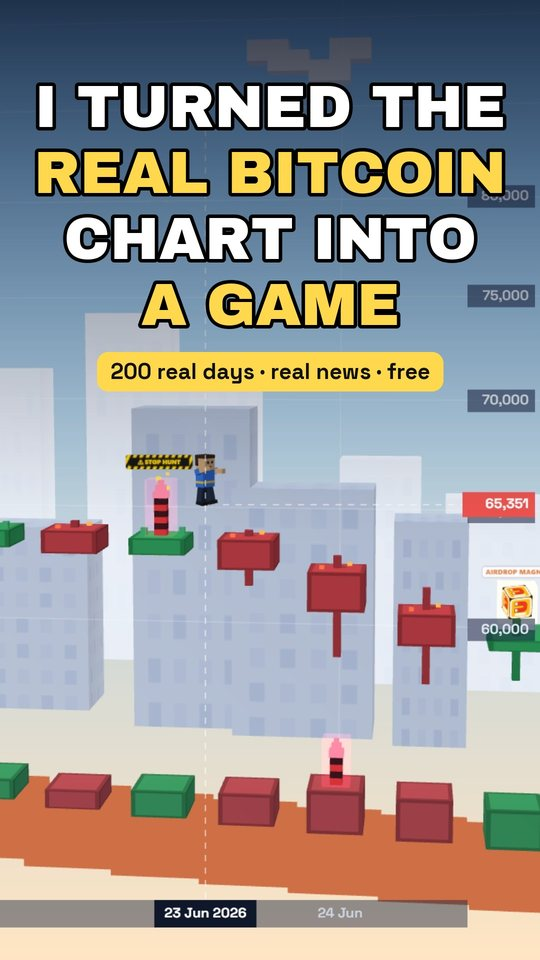
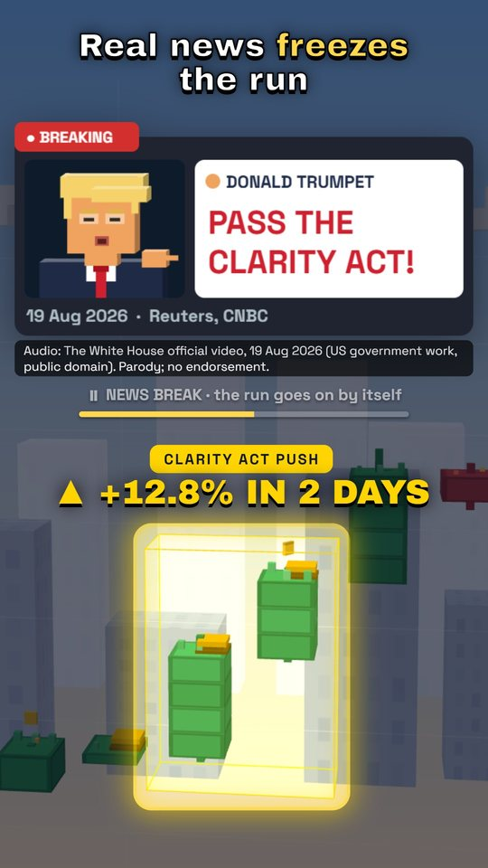
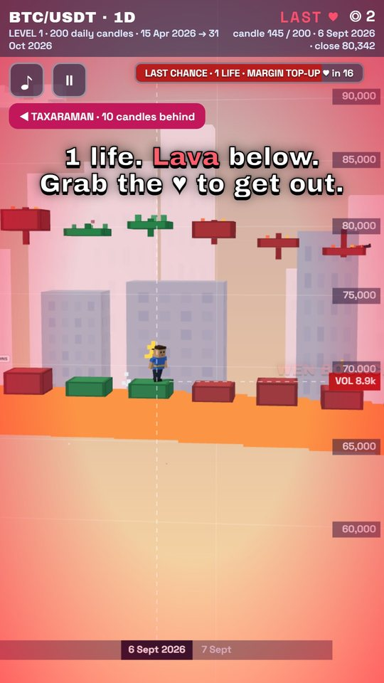

# Candle Run

<p align="center">  </p>

**Play free: https://city.peakai.si/run** (no download, works on phones)

A voxel platformer on the **real Bitcoin daily chart**. Run 200 daily candles, jump the wick spikes, slide under the
resistance lasers, take the boost pads on the big green days, cross the glass planks (dojis) fast, and outrun
**Nirmala Taxaraman**, who taxes every candle she passes 30% (she introduces herself, in her own words, before the run).
Real news events stop the run for a few seconds (no skipping: read the card, hear the line, then a second to look before the run goes on): the candles they moved light up with the move written over them
(Bitcoin Oct 2026: SpaceX going public on 12 Jun, Trump's Clarity Act push on 19-20 Aug and the Binance hack on 29 Oct;
the June 2026 liquidations show when you drop into the volume).

Play: https://candle-run-8rz.pages.dev · part of [AI Survivor City](https://city.peakai.si)

## Controls
- Keyboard: ◀ ▶ move · ▲ / W / Space jump · ▼ / S slide (hold it under lasers) · P pause · M mute · Enter start · R retry
- Phones: the runner runs by itself; ▲ jump, ▼ slide, ◀ hold back

## How a chart becomes a level
- 1 candle = 1 day. The body is the platform; height is log price (a 4% rise is one easy jump).
- Upper wicks of about 2% or more become spikes; flat runs of three candles get a resistance laser at head height;
  a rise too big to jump gets a boost pad; a doji (body under 0.12%) is a glass plank that cracks if you stand still.
- The taxman speeds up on red candles (sell-offs) and slows down on green ones, and hurries when she falls far behind.
- `tools/check_level.ts` plays every level with a bot through the same physics and fails if it cannot be finished.

## Make or update a level
```
python tools/make_level.py BTC 2026-10      # the 200 daily candles ending 31 Oct 2026 + levels_src/btc-2026-10.events.json
node tools/check_level.ts                   # prove it can be finished, show the taxman margins
```
Levels are frozen per month and updated at each month end.

## Develop
```
npm install
npm run dev        # http://127.0.0.1:5190   (?bot=1 autopilot, ?seek=N start at candle N, ?hold=1 keep event pauses open, ?last=1 start in the volume, ?debug=1 read-only state in window.__cr, ?count=test mark play counts as a test)
npm run build
python tools/deploy.py
```

## Play counts
The live game counts plays anonymously: page opened, run started, every 50th candle reached, and how and where a run ended.
Each one only adds 1 to a per-day counter in `functions/api/run.js`. The counter stores no cookies, IDs, IP addresses or
per-event rows. To tell a first run from a later one, your browser keeps a small run number (1 to 20) and sends only that
number. There is no public read; `python tools/counts.py` prints the numbers. Our own test links are kept out of the numbers,
and most automated browsers are not counted.

Code: MIT. Fonts, voices and data: see CREDITS.md. Parody characters; not financial or tax advice.
